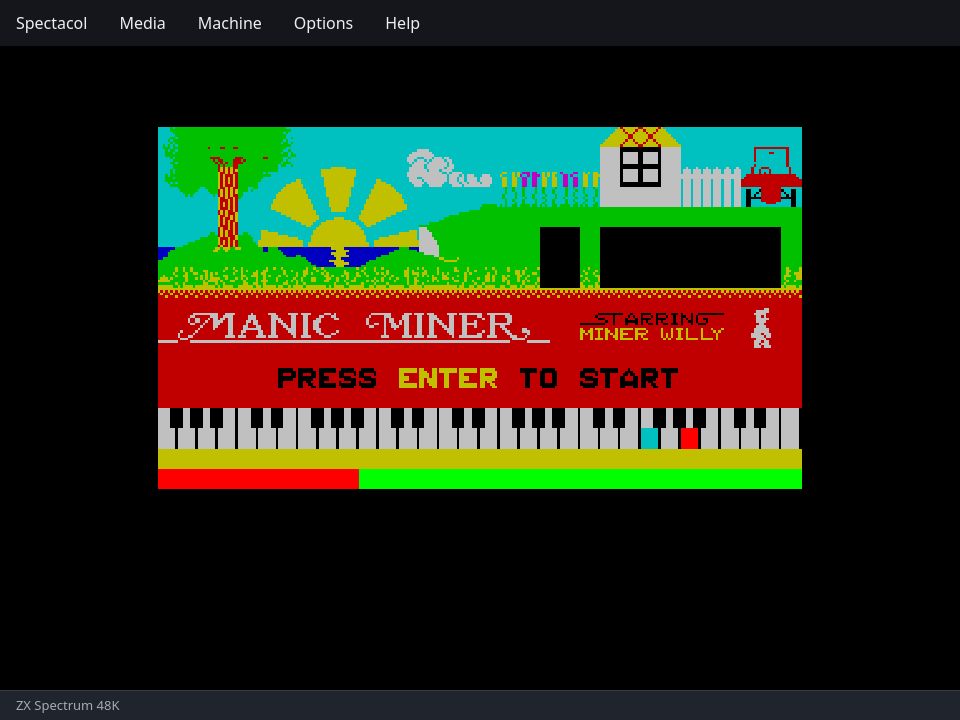
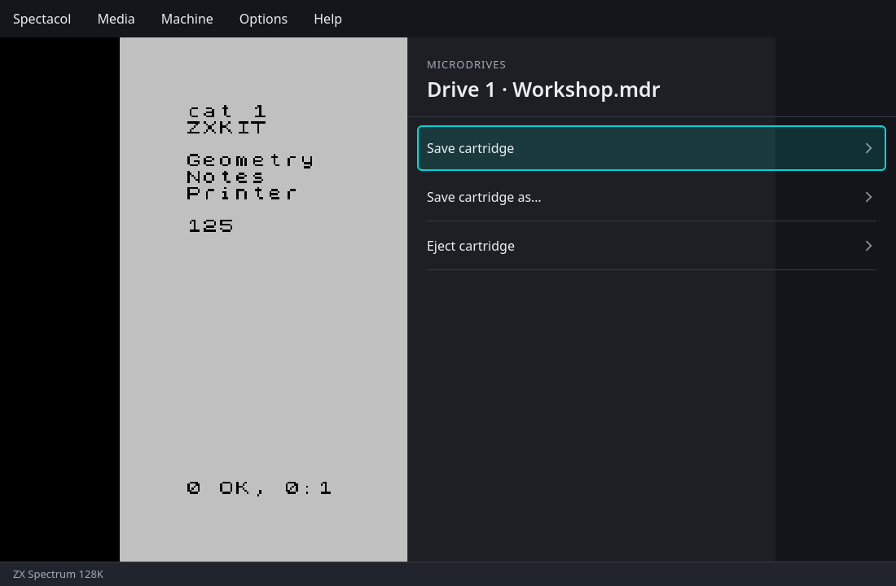
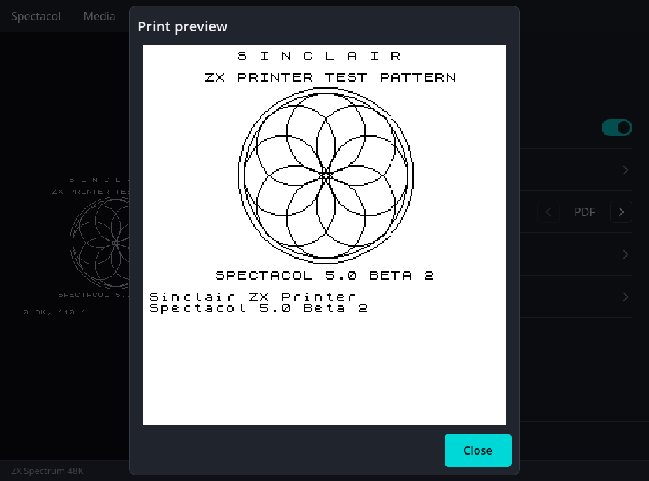
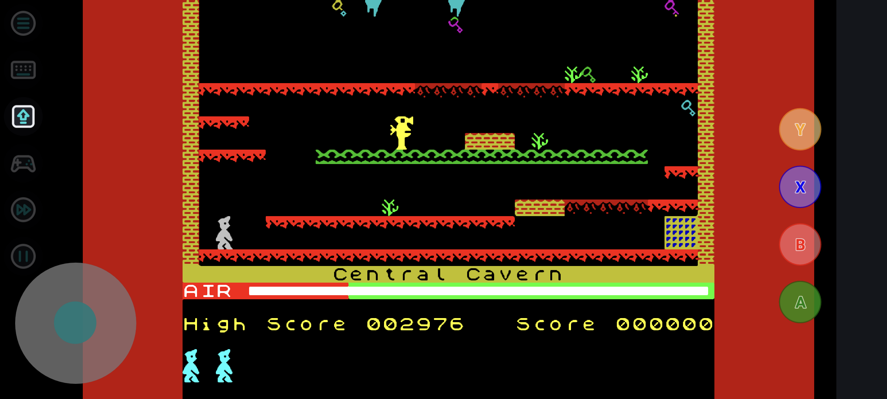
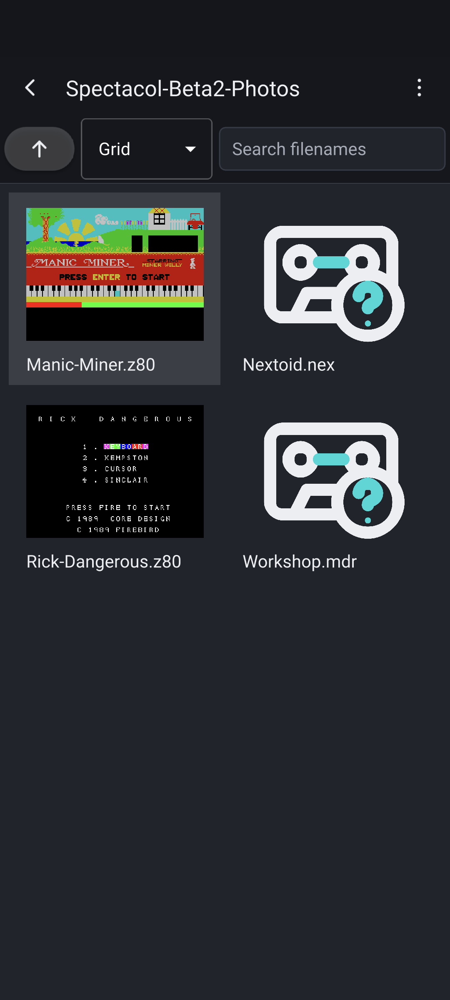

# Spectacol 5.0 Beta 2

The Microdrive is spinning again, and the ZX Printer has paper. This beta adds two
Sinclair peripherals, makes Android file handling quicker, and cuts the work needed to
run software screen filters. Thanks to everyone who tried Beta 1 and reported what broke.

## Microdrives and the ZX Printer

Open an `.mdr` cartridge on a compatible Spectrum to connect the **Sinclair Interface 1**
and mount the cartridge in the first free drive. Up to eight drives are available. Use **Media → Microdrives** to insert a blank
cartridge, save a cartridge or eject it. Try `CAT 1` from **48 BASIC** to see what’s on drive 1.

Connect the **ZX Printer** from the Media menu, then use `LPRINT` for text, `LLIST` for a BASIC
listing or `COPY` for the screen on machines that support it. The native BASIC editors on the
128K, +2, +2A, +3 and +3e can list a program with **Edit → Print**. Preview the paper and export it
as PDF, PNG, PBM or text. PDFs keep the original dots and make recognized characters selectable
and searchable. [Microdrive and printer documentation](https://github.com/bog-dan-ro/spectacol/blob/v5.0.0.2/README.md#zx-microdrive)

## Files, tapes and Android

- **File Browser** is the new name for Quick Open. Game covers load in the background on Android, and a long press opens the actions menu in cover, grid and list views.
- Add a device folder once and use it from both the File Browser and the twin-panel File Manager. Rename and delete files where the storage provider allows it. Android exports use the selected format and handle duplicate names.
- **Media → Tape → Eject** asks what to do with unsaved tape changes. The same prompt appears before replacing a modified tape. Save back to the source when possible, or choose a new file.
- SZX snapshots now restore embedded ROMs. Loading a tape program that needs a manual `RUN` stops the tape once the program is in memory.
- The File Manager adds **HC BASIC 640K disk (DSK)** for the HC-2000 and improves gamepad navigation between its panels.
- On Android, the known media folders from Beta 1 move into the app’s `Spectacol` folder. If a file already exists there, both copies are kept. The Next SD card lives under `Spectacol/Next` by default.

## Graphics, controls and machines

- Spectacol updates only the changed parts of the picture when using software filters. In a Pixel 7 test with *Windy Shaft* and xBRZ4x, CPU use went from 81.5% to 50.6% with identical pixels. Touch joystick input is sent only when the digital direction changes. [Filter benchmark](https://github.com/bog-dan-ro/spectacol/commit/492e66a9)
- **Options → General → Graphics API** lets you choose an available renderer. Relaunch Spectacol to apply the change.
- The ZX Spectrum Next can use the compact or full 48K on-screen keyboard as well as the Next layout. ZxKit can also boot through the Next firmware when a compatible FPGA boot ROM is supplied.
- Gamepad calibration shows which control to press, and Back returns to the submenu that opened a page. Spectacol also has a new icon and refreshed Android TV artwork.
- The 48K NTSC profile has been removed from Spectacol’s machine picker.

## Builds and feedback

Beta 2 adds a Docker build for the Linux x86-64 AppImage with Qt 6.12.0 and fixes a GCC 14 build error in disk loading. [Build and packaging instructions](https://github.com/bog-dan-ro/spectacol/blob/v5.0.0.2/BUILD.md)

If you hit a regression, include your device, the emulated machine and the media format.
[Report an issue](https://github.com/bog-dan-ro/spectacol/issues) · [Spectacol changes since Beta 1](https://github.com/bog-dan-ro/spectacol/compare/v5.0.0.1...v5.0.0.2) · [ZxKit v0.3](https://github.com/bog-dan-ro/ZxKit/tree/v0.3)

## AI disclosure

Spectacol and ZxKit are developed with contributions from AI assistants under human supervision.
[Project README](https://github.com/bog-dan-ro/spectacol/blob/v5.0.0.2/README.md)

---

*Manic Miner* was created by Matthew Smith and first published by Bug-Byte in 1983.
[The Centre for Computing History](https://www.computinghistory.org.uk/det/9403/Manic-Miner/)

*Rick Dangerous* was developed by Core Design and published for the Spectrum by Firebird.
[World of Spectrum archive](https://worldofspectrum.org/archive/software/games/rick-dangerous-firebird-software-ltd)

*Nextoid!* is by Lampros Potamianos. [SpecNext credits](https://www.specnext.com/about-old/)
